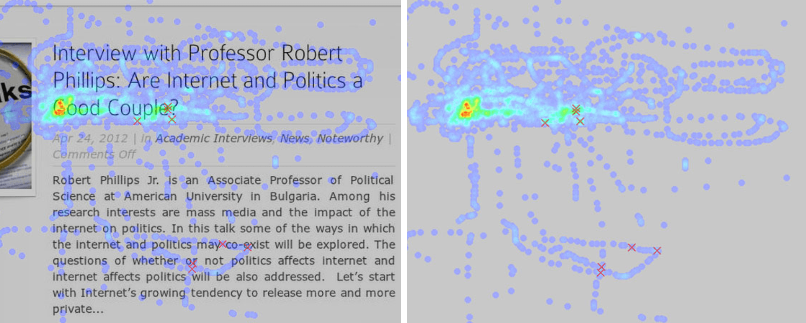
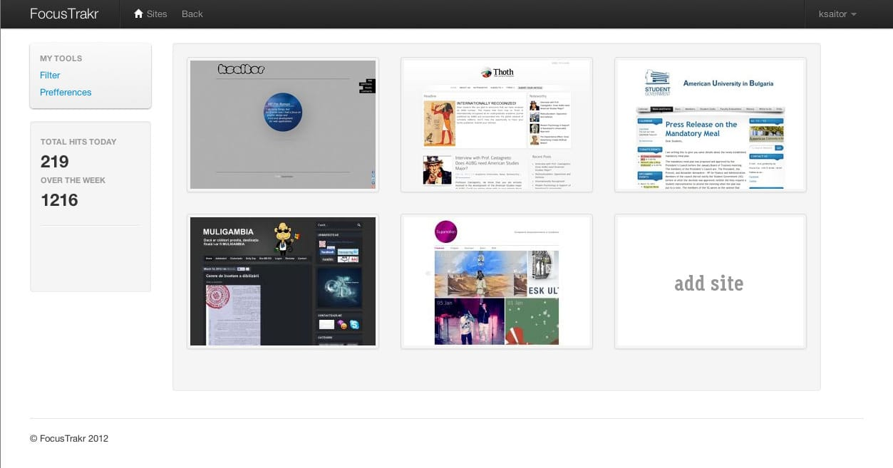
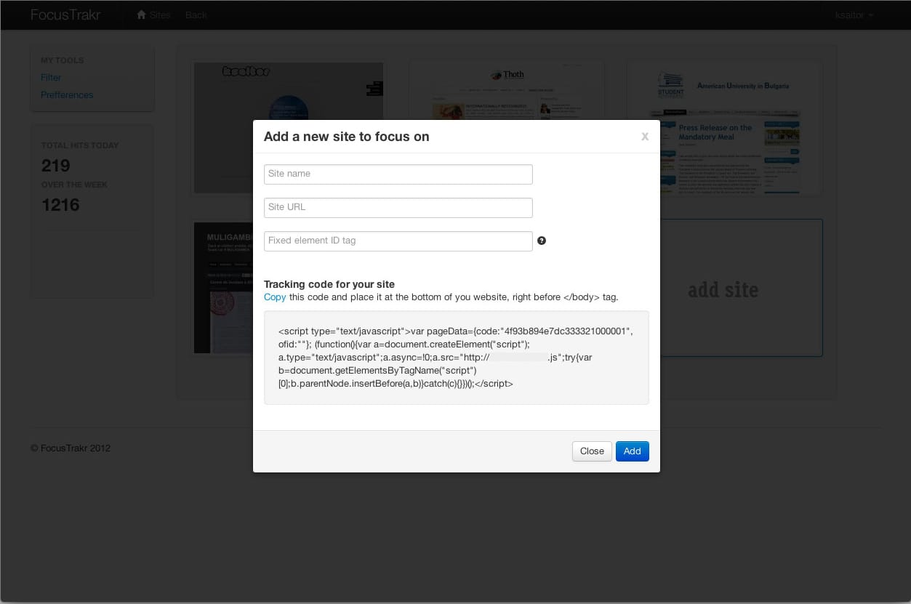
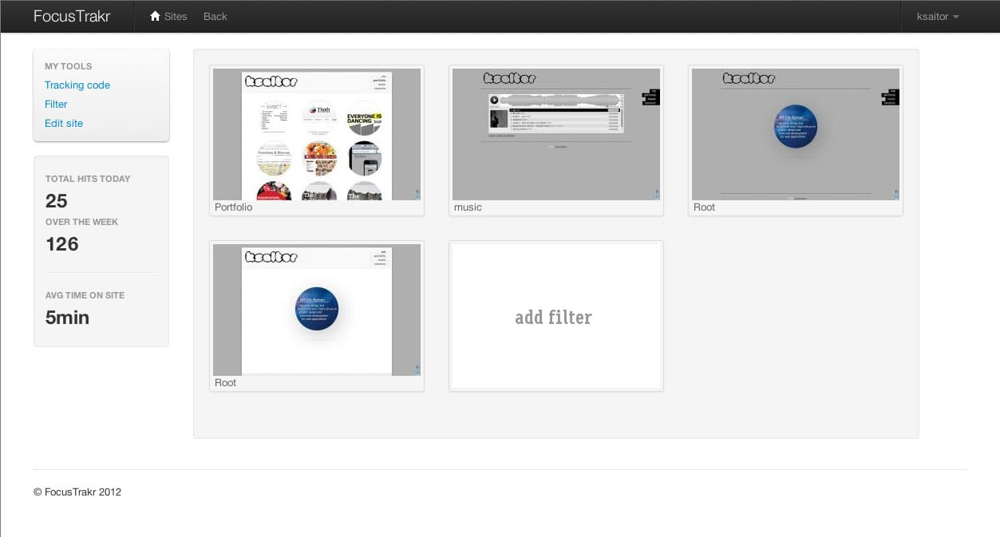
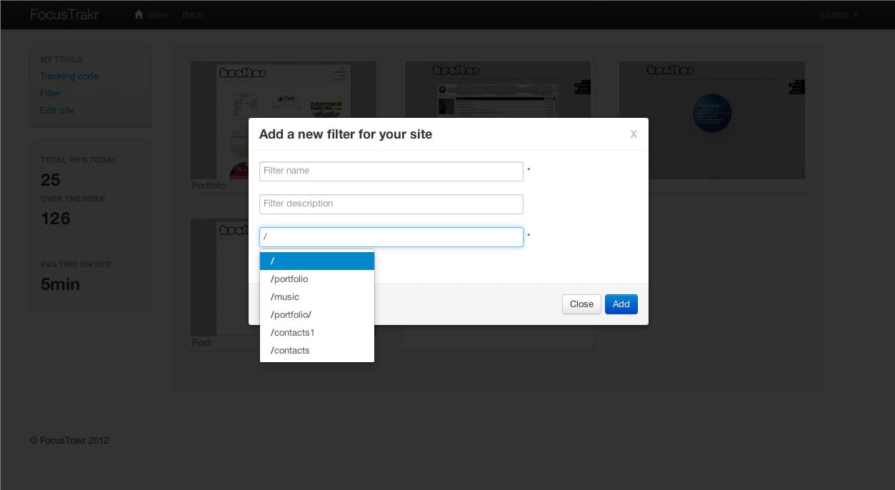
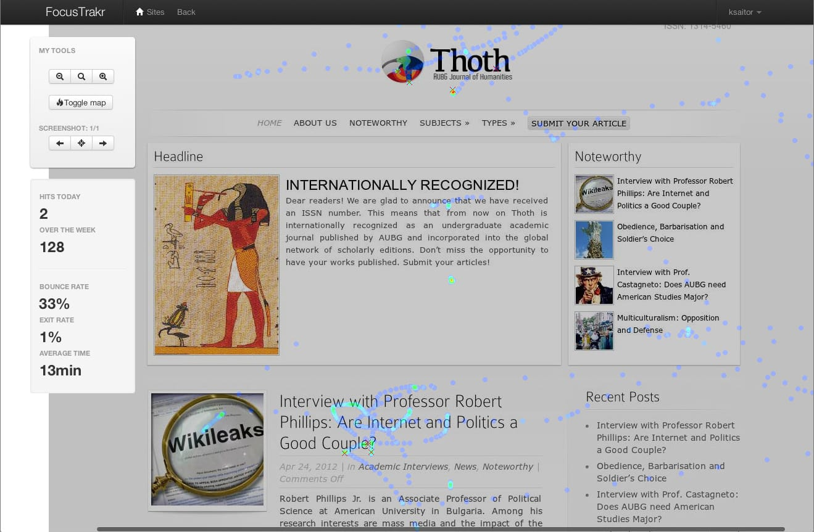
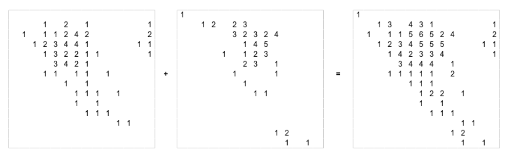
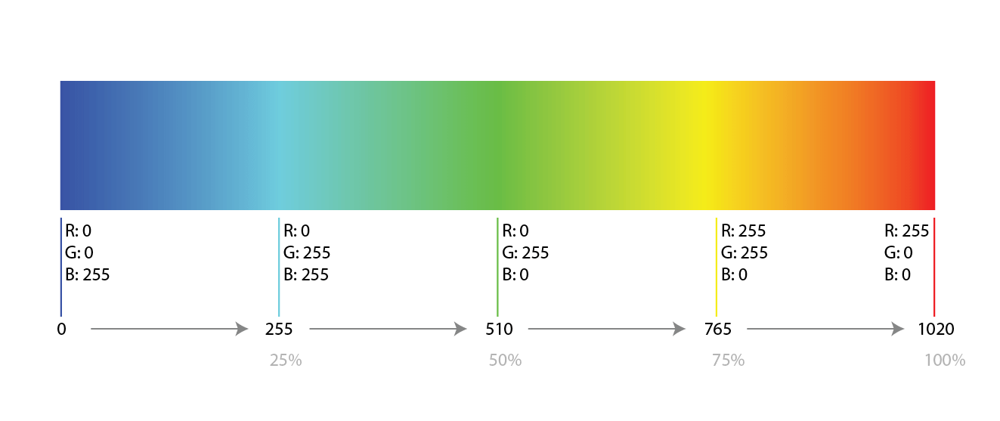

🚧 This article is under construction. Just putting up screenshots for now 👇

---

Here is a small snapshot of my Computer Science Senior Project i’m working on. FocusTrakr is an user focus analytics system developed for web applications. FocusTrakr tracks web site’s user’s attention points and presents captured data with interactive heatmaps. The system tracks site visitor’s mouse, and with pixel-perfect precession aligns mouse data to a generated screenshot of that same page.

Technologies used: Node.js, MongoDB, Memcached, Redis, Processing.js, Amazon Web Services. Page screenshot generation is also performed on the server side with xvfb, modified WebKit, modified Adobe Flash and collection of standard web fonts.

You are welcome to contact me and ask questions about the project.

23 May 2012

